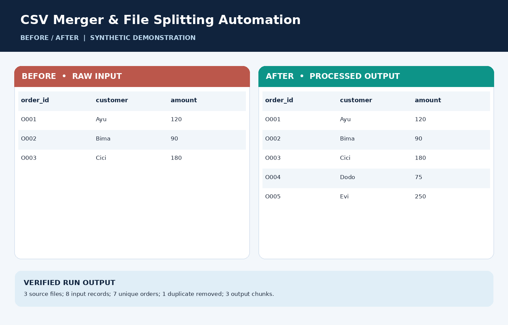

# CSV Merger & File Splitting Automation

> **Personal / sample portfolio project.** All inputs are **synthetic or fictional**. No real client work or personally identifying customer information is included.

## Problem and solution
Consolidate multiple order files, remove repeat order IDs, and split final export into smaller files.

## Verified sample results
3 source files; 8 input records; 7 unique orders; 1 duplicate removed; 3 output chunks.

## Method
Repeated order ID across input files.

## How to run
1. Have Python 3.10+ available.
2. From this directory run `python -m pip install -r requirements.txt` (needed for BeautifulSoup project only).
3. Run `python process.py`.
4. Review generated files in `output/`, plus the evidence image and report.

## Files
- `input/` — synthetic sample data
- `process.py` — runnable code
- `output/` — generated deliverables
- `screenshots/01_before_after.png` — authentic before/after representation made from sample files (not a screenshot from a client's system)
- `reports/project_evidence_report.pdf` — project summary and evidence
- `portfolio_cover_pro.png` — Upwork cover graphic
- `UPWORK_READY_COPY.txt` — description and upload instructions

## Evidence preview

## Limits
Metrics are for the bundled toy-size demonstration only. This project does not assert that millions of rows were processed or that a paid client hired me. For larger files, review memory requirements and add chunked processing as appropriate.

## Tech
Python, CSV, Automation, File Processing
